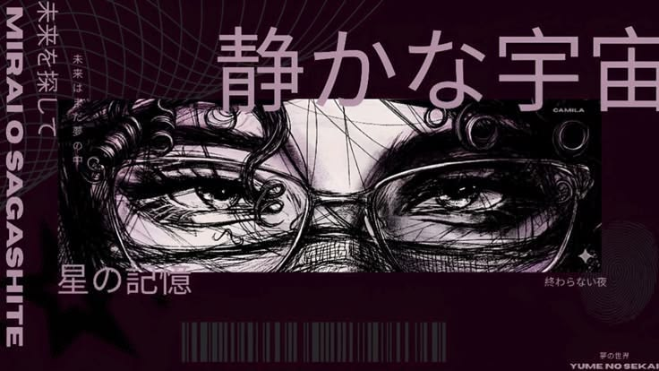

<div align="center">
  

  # Iris · `iriss-dev`

  **Penetration testing and defensive security engineering**
  Network and web assessment · Detection and ingress defense · Embedded firmware and robotics

  <p>
    
    
    
    
  </p>

  <p>
    <a href="https://twitter.com/irissmth1"></a>
    <a href="mailto:iriss.smith08@proton.me"></a>
    <a href="#responsible-disclosure"></a>
  </p>
</div>

---

## About

I assess systems the way an attacker would, then build the controls that would have stopped it. The two halves feed each other: what I find while testing becomes detection logic, and what I learn building defenses tells me where to look next.

Most of my code is low-level and measured. I write **Rust** and **C/C++** where timing has to be deterministic (microcontroller control loops, CAN/SPI protocols, kernel packet filters), **Python** and **TypeScript** for tooling, telemetry and services, and I publish the benchmarks next to the claims.

Every tool below is scoped by design: it refuses to touch what it was not explicitly pointed at, keeps secrets out of its own output, and states what it cannot see.

---

## Flagship: [Axis](https://axis-bot.app)

A multi-layered security engine that protects large Discord communities in production. Axis is my most complete work and is closed source.

- **Rogue-admin containment.** Differential damage scoring separates normal administration from destruction, and automated state rollback restores what was lost.
- **Identity signals beyond the account.** JA4 TLS handshake fingerprinting and blind HMAC account linkage connect related accounts without storing raw identifiers.
- **Zero-trust administrative vault** for the operations that must never be one compromised account away.
- Runs as a distributed cluster.

## Featured work

| Project | What it is | Notable decisions |
| --- | --- | --- |
| [**Koharu**](https://github.com/iriss-dev/koharu) | Bilingual (Spanish/English) Discord companion for anime and fashion communities: AniList cards and airing schedules in each viewer's timezone, an outfit generator, colour analysis, game deals with price alerts, anime interactions, a per-server economy and custom gradient roles. | Built on Discord Components V2 with its own 46-emoji set, uploaded as application emojis and re-synced by content hash. Payments are atomic with automatic refunds. 90 tests run every command end to end and check each reply against Discord's payload limits. |
| [**INMAP**](https://github.com/iriss-dev/INMAP) | Assessment toolkit with 16 modules: async TCP scanner (Nmap optional), Nmap XML diffing, Certificate Transparency subdomains, SPF/DMARC, HTTP/TLS/CORS checks, SQL static analysis, IaC and dependency review, CycloneDX SBOM, MCP server. | Scope is enforced in code, not by convention. Credentials are masked and tracked by keyed fingerprint. Every finding carries CWE and OWASP Top 10 mappings. Rust core for scanning and CIDR math. |
| [**KHORA**](https://github.com/iriss-dev/khora) | Open research platform linking AI agents (MCP) to hard real-time actuators: DCRA optics, 40 kHz acoustic field models, RP2040 firmware, robot kinematics. | Three-plane architecture that keeps the non-deterministic agent away from the real-time path. Ships an [engineering audit](https://github.com/iriss-dev/khora/blob/master/docs/ENGINEERING_AUDIT.md) separating what is simulated from what is measured. |
| [**BlackICE**](https://github.com/iriss-dev/blackice) | Linux ingress defense sentinel. Four independent engines (threat feeds, canary tripwires, entropy and exploit inspection, client heuristics) feed one consensus score that drives kernel-level drops. | `nftables` sets with kernel-enforced timeouts. SHA-256 hash-chained audit ledger. AES-256-GCM vault for forensic records. Offline by design, no third-party telemetry. Official MCP server for agentic IDEs. |
| [**ip-sentinel**](https://github.com/iriss-dev/ip-sentinel) | Zero-dependency, offline IP intelligence for Node.js: datacenter, Tor and VPN detection over IPv4 and IPv6. | Bitwise trie with longest-prefix match. About 1.2 µs per lookup on my machine (`npm run bench`). No network calls at runtime. |
| [**envshield**](https://github.com/iriss-dev/envshield) | Git pre-commit hook and CI scanner that blocks leaked `.env` files, API tokens and private keys before they leave the machine. | Provider-specific signatures first (Discord, OpenAI, Anthropic, GitHub, AWS, Stripe, Slack, PEM blocks), Shannon entropy only as a fallback. Zero dependencies. |

**Also:** [`draincord`](https://github.com/iriss-dev/draincord), a zero-dependency Discord webhook log drain with rate-limit backoff, failover and SQLite spooling.

---

## Pentesting and security assessment

I combine penetration testing with systems engineering to understand attack surfaces, validate controls, and turn findings into remediation that can be verified.

- **Network assessment**: host discovery, port and service enumeration, exposure mapping, configuration review. Tooling: Nmap, Wireshark, Scapy, Suricata, plus [INMAP](https://github.com/iriss-dev/INMAP).
- **Web and API security**: authentication and authorization testing, input validation, session handling, header, cookie and CORS review. Tooling: Burp Suite and purpose-built scripts.
- **Reverse engineering and binary triage**: ELF/PE inspection, entropy scanning, static analysis with Ghidra.
- **Reporting and remediation**: reproducible evidence, impact analysis, concrete fixes, and re-testing after they land.

All testing is done on systems I own or within an explicitly authorized scope, with responsible disclosure and respect for operational stability.

---

## Defensive engineering

| Area | What I build |
| --- | --- |
| Low-level and systems | Rust and C/C++ parsers, eBPF socket filters, raw netlink sockets, netfilter hooks |
| Detection engineering | Detections mapped to MITRE ATT&CK: credential access, persistence, C2, defense evasion |
| Anti-abuse and forensics | CIDR matching, JA4/TLS fingerprinting, device posture checks, velocity gates, ban-evasion correlation |
| Threat intelligence | Python pipelines for feed ingestion, ASN/BGP prefix aggregation, Tor consensus parsing |
| Binary triage and AppSec | Shannon entropy scanning, AST-based secret detection, ELF/PE header inspection, anti-tampering heuristics |
| Applied cryptography | Argon2id and peppered SHA-256 hashing, blind signatures, Ed25519 payload signing, Merkle and hash-chained audit logs |
| DFIR | Live process triage via `/proc`, memory map inspection, timeline reconstruction |
| AI agent security | MCP servers, prompt-injection tripwires, zero-width steganography detection |
| Hardening | Zero-open-port deployments with Cloudflare Tunnels, systemd cgroup isolation, namespaces, UFW/nftables, seccomp |

---

## Engineering notes

**Scope is a code path, not a promise.** INMAP's scanner raises an error when a target is not a subnet of the declared `--scope`. The safe behavior is the only behavior.

**Reports should not become the leak.** INMAP masks secret values by default and compares credentials across runs with keyed HMAC-SHA-256 fingerprints. The key file is created with `O_EXCL` and mode `0600`, so rotation can be tracked without storing plaintext. XML input goes through `defusedxml`, with regression tests for encoded entities.

**Audit your own claims.** KHORA's [engineering audit](https://github.com/iriss-dev/khora/blob/master/docs/ENGINEERING_AUDIT.md) records where the original tests were not enough to support the physical claims, and where a component named like a Kalman filter was an exponential smoother. A clean audit trail that includes the corrections is the standard I hold my own work to.

**Deception beats guessing.** In BlackICE, canary paths such as `/.env` and `/.git/HEAD` have no legitimate caller, so a hit is a signal rather than a probability. It is one of four engines, not the whole verdict.

---

## Right now

- **KHORA**: connecting MCP agents to deterministic kinematics and mid-air haptics through optical retro-reflection and 40 kHz beamforming.
- **BlackICE and `blackice-mcp`**: extending the consensus scanner and maintaining the [MCP server](https://github.com/iriss-dev/blackice/tree/main/integrations/blackice-mcp) for agentic IDE workflows.
- **Kernel ingress and eBPF**: zero-copy XDP packet drop filters that skip the userspace network stack entirely.
- **TLS handshake forensics**: JA4+ fingerprint clustering to correlate distributed bot waves and residential proxy rotation.
- **Embedded tooling**: low-latency bridges between ARM Cortex-M / ESP32 microcontrollers and autonomous software agents over serial and CAN.
- **Koharu 2.0**: a universal search across anime, fashion and deals, and a fashion assistant built on a tagged wardrobe and colour theory.

---

## Stack

<p>
  
  
  
  
  
  
  
  
  
  
</p>

<p>
  
  
  
  
  
  
  
  
</p>

<p>
  
  
  
  
  
</p>

<p>
  
  
  
  
  
</p>

---

<div align="center">
  
  
</div>

---

## Responsible disclosure

If you find a vulnerability in any of my open-source repositories, email **iriss.smith08@proton.me** with a minimal reproduction. Please use a local fixture and leave out real credentials and private targets.

```text
PGP fingerprint: 4E9A B02F 8C3D 1A7E 99DF  7B1C 52E0 3F4A 89D1 67E4
```

## Contact

- **Email**: `iriss.smith08@proton.me`
- **X / Twitter**: [@irissmth1](https://twitter.com/irissmth1)
- **GitHub**: [@iriss-dev](https://github.com/iriss-dev)
